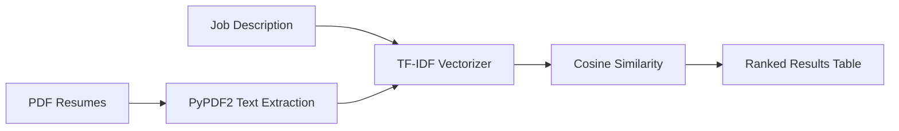

<div align="center">

# 🎯 AI Resume Screening & Candidate Ranking System

### Stop scrolling through hundreds of resumes. Let NLP find the best fit in seconds.


</div>

---

## 📖 About the Project

Hiring teams often receive dozens (or hundreds) of resumes for a single role. Reading each one manually is slow and tiring.

This project is a lightweight **AI-powered resume screener** built with **Python and Streamlit**. Give it a **job description** and a batch of **PDF resumes**, and it will:

1. 📄 Read every resume
2. 🧠 Compare it against the job description
3. 🏆 Rank candidates from best match to weakest match

No complicated setup, no black box. Just classic NLP and machine learning doing something genuinely useful.

---

## ✨ Features

- 📝 Paste any job description
- 📂 Upload **multiple PDF resumes** at once
- ⚡ Instant similarity scoring
- 📊 Clean, sorted ranking table
- 🪶 Lightweight, with only a handful of dependencies

---

## 🛠️ Tech Stack

| Technology | Role |
|---|---|
| **Python** | Core language |
| **Streamlit** | Interactive web interface |
| **PyPDF2** | Extracting text from PDF resumes |
| **Pandas** | Organising and displaying results |
| **Scikit-learn** | Machine learning toolkit |
| **TF-IDF** | Converting text into numerical vectors |
| **Cosine Similarity** | Measuring how close a resume is to the job description |

---

## ⚙️ How It Works



**Step by step:**

1. **Enter** a job description.
2. **Upload** multiple PDF resumes.
3. **Extract**: PyPDF2 pulls the text out of each resume.
4. **Vectorize**: TF-IDF turns the job description and resumes into numerical vectors.
5. **Compare**: Cosine Similarity measures how closely each resume matches the job description.
6. **Rank**: Resumes are sorted by score and shown in a table.

> 💡 **Quick intuition:** TF-IDF gives more weight to words that are distinctive and meaningful (like *"TensorFlow"*) and less to common filler words (like *"the"*). Cosine Similarity then checks how much two documents "point in the same direction".

---

## 🧩 Main Functions

### `extract_text_from_pdf()`
Extracts the raw text from an uploaded PDF resume.

### `rank_resumes()`
Compares the job description against all resumes using **TF-IDF and Cosine Similarity**, then returns a similarity score for each one.

---

## 🚀 Getting Started

### 1. Clone the repository

```bash
git clone https://github.com/Debasishjana23/AI-Resume-Screening-Candidate-Ranking-System.git
cd AI-Resume-Screening
```

### 2. Install dependencies

```bash
pip install streamlit PyPDF2 pandas scikit-learn
```

Or, if you have a `requirements.txt`:

```bash
pip install -r requirements.txt
```

### 3. Run the app

```bash
streamlit run app.py
```

Then open the URL shown in your terminal, usually:

👉 **http://localhost:8501**

---

## 📊 Example Output

| Rank | Resume | Score |
|:---:|---|:---:|
| 🥇 1 | `resume1.pdf` | **0.82** |
| 🥈 2 | `resume2.pdf` | **0.65** |
| 🥉 3 | `resume3.pdf` | **0.48** |

**A higher score means the resume is more similar to the job description.**

---

## 📁 Project Structure

```
AI-Resume-Screening/
│
├── app.py              # Main Streamlit application
├── README.md           # Project documentation
└── requirements.txt    # Python dependencies
```

---

## ⚠️ Limitations

This is a learning project, so keep these in mind:

- Matching is **keyword and vocabulary based**, so it doesn't understand deeper context or meaning.
- Scanned (image-only) PDFs may not yield any text.
- Scores should **assist** a human reviewer, not replace one.

---

## 🔮 Future Improvements

- [ ] Support for `.docx` resumes
- [ ] Semantic matching using transformer embeddings (e.g., BERT)
- [ ] Skill extraction and highlighting of missing skills
- [ ] Downloadable results as CSV
- [ ] Score visualisation with charts

---

## 🎓 Purpose

This project was created for **learning**. It demonstrates how **NLP and Machine Learning techniques can be used for basic resume screening and candidate ranking**.

---

<div align="center">

⭐ If you found this project helpful, consider giving it a star!

</div>
